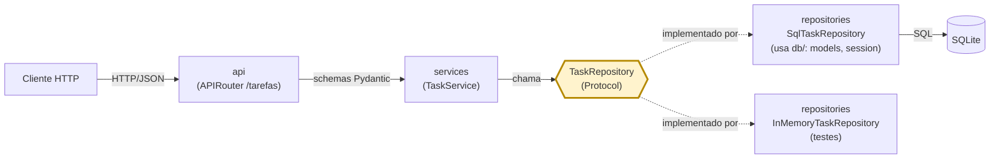

# Micro-API de Tarefas

API REST para criar, listar (com filtro por status e paginação), consultar, atualizar e excluir tarefas, construída com FastAPI, Pydantic v2 e SQLite. Miniprojeto da pós-graduação "Engenharia de Software Aplicado com IA".

O contrato público (campos do JSON, valores do enum, rotas, mensagens de erro e documentação OpenAPI) é inteiramente em **português do Brasil**; o código interno é em inglês.

**O que a API faz**

- CRUD de tarefas, com `PUT` (substituição) e `PATCH` (atualização parcial).
- Listagem filtrável por `status` e paginada (`limite`, `deslocamento`).
- Erros sempre no mesmo formato `{codigo, mensagem, detalhes[]}`, inclusive os do framework (404, 405, 422, 500).
- Persistência em SQLite via SQLAlchemy 2.x.
- Documentação interativa em `/documentacao` (Swagger UI) e `/referencia` (ReDoc).
- Interface web em `/app/` (tarefas) e `/app/#/painel` (painel gerencial), servida pela própria API.

**Em números:** 273 testes: 244 existentes na v1.0.0 e 29 novos, de servimento e segurança da interface, 100% de cobertura (mínimo exigido: 80%).

## Demonstração

O roteiro passo a passo, com a saída esperada de cada comando (PowerShell e curl), está em [docs/demo.md](docs/demo.md). Resumo do fluxo:

```text
POST /tarefas  ->  GET /tarefas?status=pendente  ->  PUT  ->  PATCH  ->  DELETE  ->  GET (404)
```

## Tecnologias

| Categoria | Tecnologia |
|---|---|
| Linguagem | Python 3.11+ (testado em 3.13.14) |
| Framework web | FastAPI 0.143.0 (sobre Starlette 1.8.0) e Uvicorn 0.54.0 |
| Validação e contrato | Pydantic 2.14.1 |
| Persistência | SQLAlchemy 2.1.4 + SQLite |
| Testes | pytest 9.1.1, pytest-cov 7.1.0, TestClient do FastAPI (via `httpx2`) |
| Interface web | HTML, CSS e JavaScript (módulos ES) puros, sem build, sem framework e sem recursos externos |
| Formatação | Black 26.10.1 |
| Diagramas | Mermaid |
| Assistentes de IA | Claude Code (modelo Claude Sonnet 5.5) no VS Code, para implementação; Claude como mentor técnico em um Project com a base de conhecimento do curso |

## Pré-requisitos

- Python 3.11 ou superior (a suíte foi executada em Python 3.13.14).
- `pip` e o módulo `venv`.
- Opcional: GNU Make (`make --version`) para os atalhos `make install|run|test|format`.

As versões das dependências estão fixadas em [requirements.txt](requirements.txt). Instalação e testes foram validados em **Windows 11 (PowerShell 5.1)**; Linux/macOS seguem os mesmos comandos, mas não foram executados nesta entrega.

## Instalação e configuração

**Windows (PowerShell)**

```powershell
python -m venv .venv
.\.venv\Scripts\Activate.ps1
python -m pip install -r requirements.txt
```

**Linux / macOS**

```bash
python3 -m venv .venv
source .venv/bin/activate
python -m pip install -r requirements.txt
```

Com `make`: `make install` (detecta o sistema e cria o `.venv` se faltar).

### Variáveis de ambiente

A configuração é lida somente de variáveis de ambiente (não há `python-dotenv`). O arquivo [.env.example](.env.example) documenta os valores; o `.env` real nunca é versionado.

| Variável | Padrão | Descrição |
|---|---|---|
| `DATABASE_URL` | `sqlite:///./tasks.db` | URL do banco. Somente SQLite é aceito; outra URL gera erro em português, sem repetir a URL. |
| `APP_ENV` | `development` | Nome do ambiente. |
| `LOG_LEVEL` | `INFO` | Um de `CRITICAL`, `ERROR`, `WARNING`, `INFO`, `DEBUG`. É lido e validado, mas ainda não configura o `logging` (ver [Limitações](#limitações)). |

Variáveis vazias ou só com espaços valem como ausentes. Exemplo de uso:

```powershell
$env:DATABASE_URL = "sqlite:///./minhas-tarefas.db"   # PowerShell
```

```bash
export DATABASE_URL="sqlite:///./minhas-tarefas.db"   # Linux/macOS
```

## Execução e uso

```powershell
python -m uvicorn app.main:app --reload
```

Com `make`: `make run`. A API sobe em `http://127.0.0.1:8000`; as tabelas são criadas na partida.

| Recurso | Endereço |
|---|---|
| Swagger UI | `http://127.0.0.1:8000/documentacao` |
| ReDoc | `http://127.0.0.1:8000/referencia` |
| Esquema OpenAPI | `http://127.0.0.1:8000/esquema-openapi.json` |
| Interface web (tarefas) | `http://127.0.0.1:8000/app/` |
| Interface web (painel) | `http://127.0.0.1:8000/app/#/painel` |

### Endpoints

| Método | Rota | Descrição | Sucesso |
|---|---|---|---|
| `POST` | `/tarefas` | Cria uma tarefa | `201` |
| `GET` | `/tarefas` | Lista com `?status=&limite=&deslocamento=` | `200` |
| `GET` | `/tarefas/{id}` | Consulta uma tarefa | `200` |
| `PUT` | `/tarefas/{id}` | Substitui (exige `titulo` e `status`) | `200` |
| `PATCH` | `/tarefas/{id}` | Atualiza parcialmente (ao menos um campo) | `200` |
| `DELETE` | `/tarefas/{id}` | Exclui | `204` |
| `GET` | `/saude` | Verificação de saúde | `200` |

**Tarefa:** `id` (UUID), `titulo` (3–100 caracteres, sem espaços nas pontas), `descricao` (opcional, até 500), `status` (`pendente` · `em_andamento` · `concluida`; padrão `pendente`), `criado_em` e `atualizado_em` (UTC).

**Listagem:** `status` (opcional), `limite` (1–100, padrão 10), `deslocamento` (≥ 0, padrão 0). Resposta: `{itens, total, limite, deslocamento}`, ordenada por `criado_em` decrescente.

### Exemplos (curl)

As saídas abaixo foram obtidas executando os comandos contra o servidor real (`uvicorn`). Os `id` e as datas mudam a cada execução.

**Criar tarefa**

```bash
curl -i -X POST http://127.0.0.1:8000/tarefas \
  -H "Content-Type: application/json" \
  -d '{"titulo": "Estudar pytest", "descricao": "Ler a documentação de fixtures"}'
```

```http
HTTP/1.1 201 Created
content-type: application/json

{"id":"dc471170-7c0c-4d6e-aaa6-6dcc991970ca","titulo":"Estudar pytest","descricao":"Ler a documentação de fixtures","status":"pendente","criado_em":"2026-10-14T16:54:04.641063Z","atualizado_em":"2026-10-14T16:54:04.641063Z"}
```

**Listar com filtro e paginação**

```bash
curl "http://127.0.0.1:8000/tarefas?status=pendente&limite=5&deslocamento=0"
```

```json
{"itens":[{"id":"dc471170-7c0c-4d6e-aaa6-6dcc991970ca","titulo":"Estudar pytest","descricao":"Ler a documentação de fixtures","status":"pendente","criado_em":"2026-10-14T16:54:04.641063Z","atualizado_em":"2026-10-14T16:54:04.641063Z"}],"total":1,"limite":5,"deslocamento":0}
```

`total` reflete o filtro, não a página. Com 3 tarefas cadastradas, `?limite=2&deslocamento=1` devolve `total` 3 e duas tarefas (da segunda mais recente em diante).

**Consultar por id**

```bash
curl http://127.0.0.1:8000/tarefas/dc471170-7c0c-4d6e-aaa6-6dcc991970ca
```

**Substituir (PUT)** — `descricao` ausente vira `null`:

```bash
curl -X PUT http://127.0.0.1:8000/tarefas/dc471170-7c0c-4d6e-aaa6-6dcc991970ca \
  -H "Content-Type: application/json" \
  -d '{"titulo": "Estudar pytest e cobertura", "status": "em_andamento"}'
```

```json
{"id":"dc471170-7c0c-4d6e-aaa6-6dcc991970ca","titulo":"Estudar pytest e cobertura","descricao":null,"status":"em_andamento","criado_em":"2026-10-14T16:54:04.641063Z","atualizado_em":"2026-10-14T16:54:06.106072Z"}
```

**Atualizar parcialmente (PATCH)** — só o `status` muda:

```bash
curl -X PATCH http://127.0.0.1:8000/tarefas/dc471170-7c0c-4d6e-aaa6-6dcc991970ca \
  -H "Content-Type: application/json" \
  -d '{"status": "concluida"}'
```

```json
{"id":"dc471170-7c0c-4d6e-aaa6-6dcc991970ca","titulo":"Estudar pytest e cobertura","descricao":null,"status":"concluida","criado_em":"2026-10-14T16:54:04.641063Z","atualizado_em":"2026-10-14T16:54:06.243543Z"}
```

**Excluir**

```bash
curl -i -X DELETE http://127.0.0.1:8000/tarefas/dc471170-7c0c-4d6e-aaa6-6dcc991970ca
```

```http
HTTP/1.1 204 No Content
```

### Erros

Toda resposta de erro tem `codigo`, `mensagem` e `detalhes` (`[]` quando não há itens). Cada item de `detalhes` tem só `campo` e `mensagem`.

| Situação | HTTP | `codigo` |
|---|---|---|
| Validação (corpo, parâmetros, UUID) | `422` | `VALIDACAO_INVALIDA` |
| Tarefa inexistente | `404` | `TAREFA_NAO_ENCONTRADA` |
| Rota inexistente | `404` | `ROTA_NAO_ENCONTRADA` |
| Método não permitido | `405` | `METODO_NAO_PERMITIDO` |
| Corpo que não é UTF-8 válido | `400` | `ERRO_HTTP` |
| Erro inesperado | `500` | `ERRO_INTERNO` (sem detalhes internos) |

```bash
curl -i -X POST http://127.0.0.1:8000/tarefas -H "Content-Type: application/json" -d '{"titulo": "ab"}'
```

```http
HTTP/1.1 422 Unprocessable Content
content-type: application/json

{"codigo":"VALIDACAO_INVALIDA","mensagem":"Os dados enviados são inválidos.","detalhes":[{"campo":"titulo","mensagem":"Deve ter no mínimo 3 caracteres."}]}
```

```bash
curl -s "http://127.0.0.1:8000/tarefas?status=invalido"
# {"codigo":"VALIDACAO_INVALIDA","mensagem":"Os dados enviados são inválidos.","detalhes":[{"campo":"status","mensagem":"Valor inválido. Valores aceitos: pendente, em_andamento, concluida."}]}

curl -s -X PATCH http://127.0.0.1:8000/tarefas/dc471170-7c0c-4d6e-aaa6-6dcc991970ca -H "Content-Type: application/json" -d '{}'
# {"codigo":"VALIDACAO_INVALIDA","mensagem":"Os dados enviados são inválidos.","detalhes":[{"campo":"corpo","mensagem":"Informe ao menos um campo para atualizar."}]}

curl -s http://127.0.0.1:8000/tarefas/dc471170-7c0c-4d6e-aaa6-6dcc991970ca   # depois do DELETE
# {"codigo":"TAREFA_NAO_ENCONTRADA","mensagem":"Tarefa não encontrada.","detalhes":[]}
```

### Exemplos (PowerShell 5.1)

O JSON bruto em UTC (com `Z` no fim das datas) está nos exemplos de curl acima. Os comandos abaixo foram executados no Windows PowerShell 5.1 e exibem os objetos com `Format-List`, porque o `ConvertTo-Json` do PS 5.1 reescreve datas como `\/Date(...)\/`.

```powershell
[Console]::OutputEncoding = [Text.Encoding]::UTF8
$B = "http://127.0.0.1:8000"
function J($o) { , [Text.Encoding]::UTF8.GetBytes(($o | ConvertTo-Json -Compress)) }

# Criar
$t = Invoke-RestMethod -Method Post -Uri "$B/tarefas" -ContentType "application/json; charset=utf-8" `
       -Body (J @{ titulo = "Estudar pytest"; descricao = "Ler a documentação de fixtures" })
$t | Format-List

# Listar com filtro e paginação
(Invoke-RestMethod -Uri "$B/tarefas?status=pendente&limite=5&deslocamento=0").itens | Format-List

# Substituir, atualizar parcialmente e excluir
Invoke-RestMethod -Method Put   -Uri "$B/tarefas/$($t.id)" -ContentType "application/json; charset=utf-8" `
  -Body (J @{ titulo = "Estudar pytest e cobertura"; status = "em_andamento" }) | Format-List
Invoke-RestMethod -Method Patch -Uri "$B/tarefas/$($t.id)" -ContentType "application/json; charset=utf-8" `
  -Body (J @{ status = "concluida" }) | Format-List
Invoke-WebRequest -Method Delete -Uri "$B/tarefas/$($t.id)" -UseBasicParsing | Select-Object StatusCode, StatusDescription
```

Saída de `$t | Format-List` (literal, no PS 5.1; o `ã` de `documentação` aparece corrompido só na **exibição**, ver armadilhas abaixo):

```text
id            : dcd2ace5-b220-4ff4-aaf4-a08983b5fe29
titulo        : Estudar pytest
descricao     : Ler a documentação de fixtures
status        : pendente
criado_em     : 2026-10-14T17:08:03.176666Z
atualizado_em : 2026-10-14T17:08:03.176666Z
```

Para ler o corpo de um erro no PS 5.1, use `$_.ErrorDetails.Message`:

```powershell
try {
  Invoke-RestMethod -Method Post -Uri "$B/tarefas" -ContentType "application/json; charset=utf-8" -Body (J @{ titulo = "ab" })
} catch {
  "status: $([int]$_.Exception.Response.StatusCode)"   # 422
  $_.ErrorDetails.Message | ConvertFrom-Json | Format-List
}
```

**Armadilhas de codificação do PowerShell 5.1** (observadas ao executar os exemplos):

- Passar o corpo como *string* com acento (por exemplo `-Body '{"titulo": "ação"}'`) envia bytes Latin-1; a API responde `400` `ERRO_HTTP`. Envie sempre **bytes UTF-8** (função `J` acima) e `charset=utf-8`.
- O PS 5.1 decodifica respostas `application/json` sem `charset` como ISO-8859-1, então `Invoke-RestMethod` pode exibir `demonstração`. Os dados no servidor estão corretos (veja o curl). Para ver os acentos, decodifique `RawContentStream` como UTF-8 com `Invoke-WebRequest`, ou use o PowerShell 7+.

## Interface web

Uma interface web simples acompanha a API e é servida por ela, na mesma origem (sem CORS). São arquivos estáticos em `app/static/` (HTML, CSS e JavaScript puros): não há build, framework, CDN nem fontes externas, então funciona offline. Decisão registrada em [ADR-0003](docs/adr/0003-interface-web-estatica.md).

Com a API no ar (`make run`):

| Tela | Endereço | Para que serve |
|---|---|---|
| Tarefas | `http://127.0.0.1:8000/app/` | Criar, listar, filtrar, editar, concluir e excluir tarefas |
| Painel | `http://127.0.0.1:8000/app/#/painel` | Visão gerencial: totais, distribuição por status, progresso e últimas tarefas |

### Como usar (passo a passo)

**Criar uma tarefa**
1. Em **Tarefas**, preencha o **Título** (e, se quiser, a **Descrição**) no cartão "Nova tarefa".
2. Clique em **Criar tarefa**. A tarefa aparece no topo da lista com o status "Pendente".
3. Se os dados forem inválidos, a mensagem da API aparece no formulário e nada é criado.

**Filtrar e navegar**
1. Use os botões **Todas**, **Pendentes**, **Em andamento** e **Concluídas**.
2. A lista mostra 10 tarefas por página. Use **Anterior** e **Próxima**; o resumo indica a página e o total.

**Mudar o status**
- Cada cartão tem um único botão de avanço: **Iniciar** (pendente → em andamento), **Concluir** (em andamento → concluída) ou **Reabrir** (concluída → pendente).

**Editar**
1. Clique em **Editar** no cartão, altere título e/ou descrição e clique em **Salvar**. **Cancelar** (ou a tecla `Esc`) descarta a alteração.
2. Apagar a descrição e salvar volta a mostrar "Sem descrição.".

**Excluir**
1. Clique em **Excluir**: o cartão pede confirmação ("Excluir esta tarefa?").
2. **Confirmar exclusão** apaga a tarefa; **Cancelar** mantém.

**Painel**
- Mostra o total e os totais por status, a distribuição em barras, o progresso de conclusão e as 5 últimas tarefas (datas no horário de Brasília). **Atualizar** busca os números de novo.

> A interface não valida os dados por conta própria: exibe a `mensagem` e os `detalhes` que a API devolve. Isso mantém uma única fonte de regras.

## Testes e cobertura

```powershell
python -m pytest --cov=app --cov-report=term-missing --cov-fail-under=80
```

Com `make`: `make test`. Estado atual: **273 testes passando, 100% de cobertura**. O comando falha se a cobertura ficar abaixo de 80%.

- `tests/unit` (132 testes): `test_repository_contract.py` (46, roda contra a implementação em memória e a SQL), `test_task_schemas.py` (32), `test_task_service.py` (28), `test_sql_repository.py` (11), `test_sql_session.py` (7), `test_settings.py` (5), `test_utc_datetime.py` (3).
- `tests/integration` (141 testes): `test_tasks_api.py` (39), `test_error_handling.py` (25), `test_web_static.py` (29, servimento da interface em `/app` e regras de segurança do código estático), `test_openapi_names.py` (12), `test_sql_file_api.py` (12, SQLite em arquivo), `test_tasks_patch_api.py` (12), `test_language.py` (9, o **teste de idioma**) e `test_app_factory.py` (3).
- **O JavaScript da interface não tem testes automatizados** (ver Limitações): `test_web_static.py` verifica que os arquivos são servidos com o tipo correto, que não há script nem estilo inline e que o código não usa `innerHTML`, `eval` e similares.
- **Hermeticidade (verificável):** a API é chamada em processo, pelo `TestClient` do FastAPI (`tests/integration/conftest.py`), sem servidor nem socket; `grep` em `tests/` não encontra `requests`, `socket`, `urllib`, `uvicorn` nem URLs `http(s)://`. O banco é SQLite em memória (`sqlite://`) ou em arquivo dentro de `tmp_path`, e `tests/conftest.py` fixa `DATABASE_URL=sqlite://` em todos os testes.

A cobertura sozinha não prova qualidade: por isso cada etapa teve **prova de mutação** (alterar o código de propósito e conferir que o teste certo falha).

## Estrutura e arquitetura

```text
app/
  main.py                  # create_app(): monta handlers, OpenAPI e repositório
  api/                     # rotas (tasks.py, health.py), dependências, handlers de erro, OpenAPI em PT-BR
  core/                    # config.py (variáveis de ambiente), errors.py, messages.py (todos os textos)
  db/                      # models.py (modelo ORM e UtcDateTime), session.py (engine e sessões)
  models/task.py           # entidade Task e enum TaskStatus
  repositories/            # base.py (Protocol), in_memory.py, sql_repository.py
  schemas/                 # contrato Pydantic (task, error, health)
  services/task_service.py # regras de negócio
  static/                  # interface web (servida em /app): index.html, style.css, js/ (módulos ES; messages.js centraliza os textos)
tests/                     # unit/ e integration/
docs/                      # requisitos, architecture, demo, adr/
```

Camadas: `api` → `services` → `repositories` → banco. A regra de negócio fica somente em `services`; o serviço depende do `Protocol` `TaskRepository`, nunca de uma implementação concreta.



Os diagramas de sequência (`GET /tarefas`) e da entidade `Task` (contrato PT-BR ↔ código EN) estão em [docs/architecture.md](docs/architecture.md).

### Documentação e decisões

- [docs/requisitos.md](docs/requisitos.md): requisitos v1.3, contrato de erro e plano de commits.
- [docs/architecture.md](docs/architecture.md): diagramas e trade-offs.
- [docs/demo.md](docs/demo.md): roteiro de demonstração.
- [ADR-0001](docs/adr/0001-miniprojeto-e-stack.md): escolha do miniprojeto e da stack.
- [ADR-0002](docs/adr/0002-persistencia-sqlalchemy-sqlite.md): persistência com SQLAlchemy 2.x e SQLite.
- [ADR-0003](docs/adr/0003-interface-web-estatica.md): interface web estática servida pela própria API, sem build.

## Como a IA acelerou este projeto

O projeto foi construído com **Claude Code** (modelo Claude Sonnet 5.5) no VS Code, sob a orientação de Claude como mentor técnico em um Project com a base de conhecimento do curso. Esta seção usa somente o registro de uso de IA mantido durante o desenvolvimento.

### Tempo

As horas previstas vêm do plano de commits (requisitos §11). As horas estimadas foram calculadas ao final do projeto, com base no histórico das conversas de trabalho; não houve cronometragem. Não há, portanto, cálculo de ganho de produtividade em percentual nem estimativa de "tempo sem IA".

| Sessão | Escopo (commits) | Previsto no plano | Estimado | Resultado | Ganho (qualitativo) |
|---|---|---|---|---|---|
| 1 | Fundação: estrutura, docs, 3 diagramas Mermaid (1–2) | ~3 h | ~3 h | 2 commits Conventional; Mermaid validado no mermaid.live | Alto (docs e scaffolding) |
| 2 | Núcleo com TDD: schemas, repositório em memória, serviço (3–5) | ~9 h | ~3 h | 82 testes, 100% de cobertura; 3 provas de mutação (`min_length`, ordenação, `updated_at`/PATCH) derrubaram os testes certos | Alto (testes e scaffolding) |
| 3 | API HTTP (6, 7 e 7b) | ~9 h | ~4 h | 177 testes, 100% de cobertura; mutações em cada commit; OpenAPI sem textos em inglês | Alto |
| 4 | Persistência SQLAlchemy + SQLite (8–9) | ~6 h | ~3 h | 244 testes, 100% de cobertura; 4 mutações no commit 8 e 6 no commit 9, todas pegas; persistência provada com `uvicorn` real | Alto |
| 5 | Entrega: README, demonstração, Makefile e dependências (10–11) | ~4 h | ~2 h | README, demonstração, Makefile e requirements final; 244 testes, 100% | — |
| **Total** | | **~31 h** | **~15 h** | | |

Após a v1.0.0, a interface web foi desenvolvida no mesmo ciclo (Plan mode, revisão e commit com aprovação); as horas dela não foram estimadas.

### O ciclo de trabalho

1. **Plan mode:** a IA propunha um plano curto (arquivos, riscos, dúvidas) e eu o revisava antes de qualquer edição.
2. **Aprovação manual** de cada edição e de cada commit, com a mensagem exata mostrada antes.
3. **TDD (RED → GREEN → refatorar):** teste que falha primeiro, o mínimo para passar, depois limpeza.
4. **Prova de mutação:** alterar o código de propósito (por exemplo, o `min_length` do título ou a ordenação) e exigir que o teste certo quebre. Foi o que separou cobertura de 100% de qualidade dos asserts.
5. **Revisão crítica:** conferir o que a IA afirmava contra a documentação e contra o ambiente (por exemplo, `pip freeze` para confirmar a versão do SQLAlchemy).
6. **Smoke test com `uvicorn` real:** pegou o que os testes não pegariam.

### O que a IA errou (ou o ambiente atrapalhou) e como foi detectado

A coluna da direita só afirma a detecção quando o registro de uso a descreve; nos demais casos consta apenas a lição registrada.

| Problema | Detecção / lição registrada |
|---|---|
| Inconsistências entre `CLAUDE.md`, requisitos e ADR (referências aos docs 03/07) | A própria IA apontou na sessão 1; corrigidas antes do commit |
| Ambiente Windows: `&&` inválido no PS 5.1, pasta System32, encoding UTF-8 no `Get-Content`, autor Git ausente | Lição da sessão 1 |
| `>` do PowerShell 5.1 grava UTF-16; regravar arquivos com PowerShell corrompeu acentos | Lições das sessões 2 e 3: usar `Set-Content -Encoding ascii` e as ferramentas Edit/Write |
| Cobertura de 100% não prova qualidade | Por isso as provas de mutação, que derrubaram os testes certos |
| Teste de imports por texto é frágil | Lição da sessão 2: usar `ast` |
| `InvalidDataError` sem uso | Removida (YAGNI) |
| `type: ignore` no PATCH e `mypy` ainda não rodado | Lição da sessão 2; mypy fica em Próximos Passos |
| FastAPI vazava inglês no OpenAPI ("Successful Response", `HTTPValidationError`) e docstrings dos schemas viravam documentação | Registrado na sessão 3; renome em commit próprio (7b) |
| `httpx` gerava aviso de depreciação do Starlette; a troca por `httpx2` precisou ser checada contra a documentação | A IA precisou ser checada contra a documentação (sessão 3) |
| Desempate por `id` ausente no repositório em memória | Revelado pela suíte de contrato compartilhada (sessão 4) |
| No commit 9 só a validação de URL teve RED real (o resto era caracterização) | A prova de mutação fez o papel do RED |
| O 500 poderia vazar SQL, tabela ou caminho | O teste de vazamento pegou a mutação `str(exc)` |
| `uvicorn` real revelou o que os testes não pegariam | Smoke test da sessão 3 |
| "Credit balance is too low" interrompeu uma sessão | Lição da sessão 3: conferir login e saldo antes |

### Decisões-chave registradas

Idioma v1.2 (código em inglês, contrato em português por aliases e valores de enum); `PATCH` com `null` explícito; repositório único `update(task) -> bool`; sessão curta por operação; só SQLite no MVP; configuração só por variáveis de ambiente. O log completo está em [docs/adr/](docs/adr/) e em `docs/requisitos.md`.

## Limitações

Limitações conhecidas (as da interface web, ao final da lista, são posteriores à v1.0.0).

- **A entrada também aceita nomes internos em inglês** (por exemplo `{"title": "..."}`), por causa de `populate_by_name=True`, necessário para montar a resposta a partir da entidade. É documentado por teste; a saída sempre usa o contrato em português.
- **O traceback do log do erro 500 sai em inglês** (uvicorn/Python). A resposta ao cliente é sempre em português e não vaza detalhes internos.
- **`LOG_LEVEL` é lido e validado, mas ainda não configura o `logging`** (`app/` não contém `basicConfig`, `dictConfig` nem `setLevel`).
- **Rótulos do Swagger UI e do ReDoc ficam em inglês** (vêm do framework); títulos, descrições e exemplos estão em português.
- **Somente SQLite**; outra URL é recusada com erro em português.
- **Sem autenticação nem autorização.**
- **Sem migrações** (sem Alembic): mudar o esquema exige recriar o banco ([ADR-0002](docs/adr/0002-persistencia-sqlalchemy-sqlite.md)).
- **Sessão por operação do repositório:** não há transação que abranja várias operações.
- **`httpx2` no lugar de `httpx`:** o TestClient do Starlette emitia aviso de depreciação com `httpx`; `httpx2` é um fork mantido pela Pydantic com a mesma API. Decisão registrada no log de decisões.
- **Corpo que não é UTF-8 válido** responde `400` com `ERRO_HTTP` (em português), e não `422` `VALIDACAO_INVALIDA`.
- **O cabeçalho `Allow` do `405`** em `DELETE /tarefas` listou apenas `POST` ao executar os exemplos, embora a rota também aceite `GET`. Observado; causa provável: comportamento do Starlette com rotas separadas para o mesmo caminho; não investigado.
- **Testado apenas no Windows** (Python 3.13.14); Linux/macOS e Python 3.11/3.12 não foram exercitados.
- **Interface web: sem testes automatizados do JavaScript.** A validação do comportamento (foco, edição inline, confirmação, painel) foi manual; os testes cobrem só o servimento estático e a segurança do código.
- **Interface web: a edição aberta é descartada em qualquer recarga** (mudar de filtro ou de página, mudar o status ou excluir outra tarefa, ou abrir outra edição). Não há rascunho.
- **Painel: é uma fotografia dos números** do momento da última atualização, sem tempo médio nem séries por dia, porque a API não fornece esses dados. Os totais vêm de 4 chamadas a `GET /tarefas` que não são atômicas; se houver escrita entre elas, a tabela de últimas tarefas pode divergir de um total em uma unidade.
- **Interface web: sem central de ajuda dentro da tela.** O passo a passo está neste README.

## Próximos Passos

- PostgreSQL + Alembic (migrações).
- Autenticação e autorização.
- Logging configurável por `LOG_LEVEL`.
- Tipagem estática com mypy e lint com ruff.
- CI com GitHub Actions (testes e cobertura a cada push).
- Docker.
- Ordenação configurável na listagem.
- Endpoint de resumo (por exemplo `GET /tarefas/resumo`) para o painel buscar os números em uma única chamada e permitir tempo médio e séries por dia.
- Testes de interface com Playwright (cobrir foco, edição inline, confirmação e painel).
- Central de ajuda dentro da interface (manual de uso na própria tela).
- Integração com LLM (somente aqui; fora do escopo do MVP).

## Créditos e licença

Projeto de **Andreo Barbassa Costa**, miniprojeto da pós-graduação "Engenharia de Software Aplicado com IA". Desenvolvido com Claude Code (Claude Sonnet 5.5) e orientação técnica de Claude.

Distribuído sob a licença **MIT** (arquivo [LICENSE](LICENSE)).

**Contribuições:** abra uma *issue* ou *pull request* no repositório (https://github.com/andreobcosta/Micro_API_Tarefas). Use Conventional Commits (tipos em inglês, descrição em português), mantenha os testes passando com cobertura ≥ 80% e atualize a documentação junto com o código.
