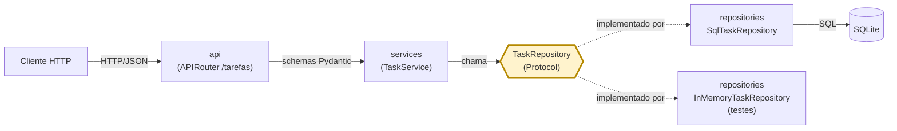
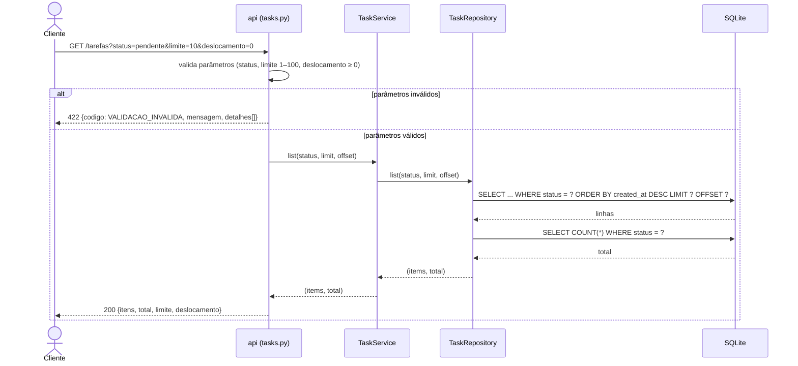
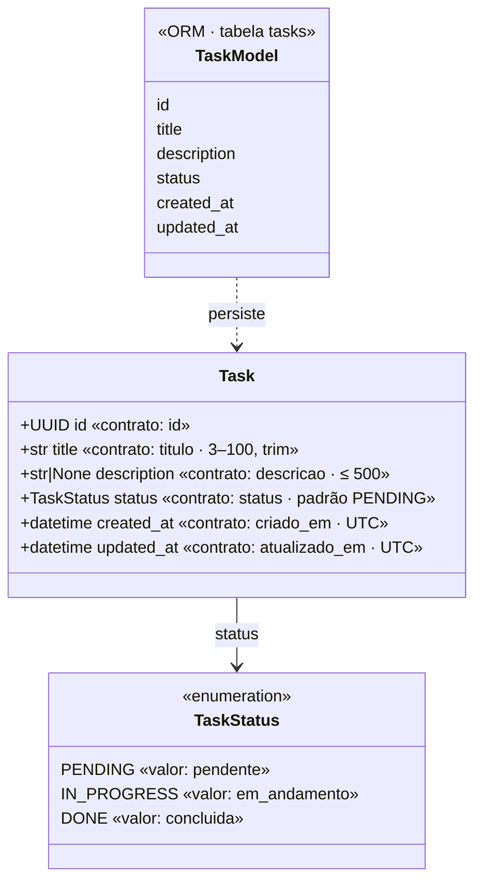

# Arquitetura — Micro-API de Tarefas

Visão da arquitetura em camadas. Requisitos em [requisitos.md](requisitos.md); decisão de stack em [adr/0001-miniprojeto-e-stack.md](adr/0001-miniprojeto-e-stack.md).

## 1. Componentes

A regra de negócio fica somente em `services`. O serviço depende da interface `TaskRepository` (Protocol), nunca de uma implementação concreta; a implementação é injetada via `Depends`.

## 2. Sequência — `GET /tarefas?status=&limite=&deslocamento=`

## 3. Entidade `Task` — contrato (PT-BR) ↔ código (EN)

O contrato público usa português (via `Field(alias=...)` e valores do enum); o código e o banco usam inglês (§4.1 do requisitos).

## 4. Decisões e trade-offs

- **Camadas `api` → `services` → `repositories`:** isolam regra de negócio de HTTP e de banco; custo é um pouco mais de código para um CRUD pequeno.
- **`TaskRepository` como Protocol:** permite testar os serviços com `InMemoryTaskRepository`, sem banco, e trocar o SQLite por PostgreSQL no futuro (Próximo Passo).
- **SQLite via SQLAlchemy 2.x:** zero setup e sem segredos; não cobre concorrência de produção.
- **Contrato em português, código em inglês:** aliases do Pydantic e enum com valor em português separam API pública da implementação; a camada de tradução é protegida por testes de contrato.
- **Erros do framework em inglês:** exigem handlers globais e mensagens centralizadas em `app/core/messages.py`, com teste automatizado de idioma.
- **Swagger UI/ReDoc:** os rótulos da interface permanecem em inglês (framework); mitigado com títulos, descrições e exemplos em português.
- **Listagem sempre paginada** (limite máximo 100), ordenada por `criado_em` decrescente: evita respostas ilimitadas, sem ordenação configurável no MVP.
